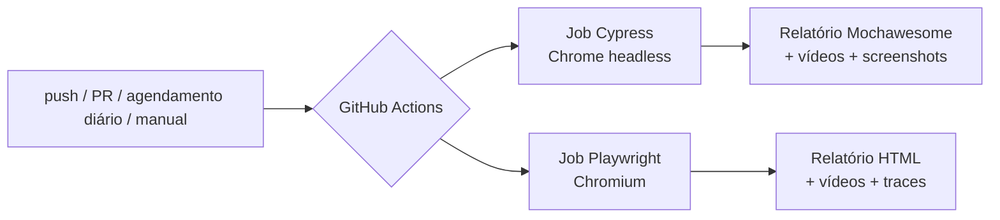

<h1 align="center">🧪 Portfólio de QA Automation</h1>

<p align="center">
  <b>Testes E2E com Cypress e Playwright, rodando em CI/CD no GitHub Actions</b><br>
  <sub>Pietro Souza Cardoso · Quality Assurance · <a href="https://www.linkedin.com/in/pietro-de-souza-cardoso-1b2333224/">LinkedIn</a></sub>
</p>

<p align="center">
  <a href="https://github.com/Pietro19/Portfolio_QA/actions/workflows/ci.yml"></a>
  
  
  
  
  
  
</p>

---

## 📊 Resumo

| | |
|---|---|
| **Testes automatizados** | **134** (104 Cypress + 30 Playwright) |
| **Aplicações reais testadas** | 3: Scoder (institucional), Inatel (educacional), SauceDemo (e-commerce) |
| **Frameworks** | Cypress (JavaScript) e Playwright (TypeScript) |
| **CI/CD** | GitHub Actions: 2 jobs em paralelo, execução em todo push/PR + execução diária agendada |
| **Evidências geradas** | Relatório HTML (Mochawesome / Playwright), vídeos, screenshots e traces de falha |

> Todos os testes rodam contra **sites reais em produção**, não contra exemplos prontos. A execução diária agendada funciona como um monitor de regressão: se algo mudar nos sites, o pipeline acusa.

---

## 🎯 Competências demonstradas

- **Desenho de cenários de teste**: positivos, negativos, de borda (emoji, input numérico, string gigante), de UI, de navegação e de conteúdo
- **Testes não funcionais básicos**: usabilidade (Tab/Enter/foco), segurança (acesso sem login, sessão após logout), sessão/refresh, performance (tempo de login) e responsividade (viewport)
- **Duas ferramentas de mercado**: a mesma suíte do Inatel foi implementada em **Cypress e em Playwright**, permitindo comparar as abordagens lado a lado
- **Documentação de defeito no código**: uso de `test.fail()` no Playwright para registrar um comportamento divergente conhecido sem quebrar o pipeline
- **CI/CD de testes**: pipeline com cache de dependências, `npm ci` reprodutível, retries apenas em CI, cancelamento de execuções obsoletas e publicação de artefatos
- **Organização**: testes separados por aplicação e por funcionalidade, seletores estáveis (`data-test`, `href`, texto) e scripts `npm` padronizados
- **Testes resilientes a efeitos colaterais do site**: tratamento do banner de cookies (que recarrega a página) antes das interações, evitando testes instáveis

---

## 🗂️ Cobertura por aplicação

| Aplicação | Tipo | Cypress | Playwright | O que é validado |
|---|---|:---:|:---:|---|
| [Scoder](https://www.scoder.com.br) | Site institucional | 54 | – | Navegação por menu/scroll, 5 seções de conteúdo, formulário "Agendar Call" (obrigatórios, limite de caracteres), versão em inglês, rodapé completo |
| [SauceDemo](https://www.saucedemo.com) | E-commerce | 40 | 20 | Login (válido, inválido, bloqueado, campos vazios, bordas), produtos, carrinho, ordenação, menu lateral, logout, **fluxo E2E de compra**, segurança, sessão e performance |
| [Inatel](https://inatel.br) | Site educacional | 10 | 10 | Carregamento da home, botões "Vestibular 2027" e "Mais notícias", redirecionamento dos cards Graduação, Pós-Graduação, Mestrado/Doutorado e Capacitações, link do Inatel Online |
| **Total** | | **104** | **30** | **134 testes** |

<details>
<summary><b>🔍 Detalhes: Playwright × SauceDemo (20 testes)</b></summary>

| Categoria | Exemplos de cenários |
|---|---|
| Funcional | Login com sucesso, credenciais inválidas, campos vazios, usuário bloqueado |
| UI | Campos Username/Password visíveis, botão Login habilitado, logo |
| Usabilidade | Login com Enter, foco no campo, navegação com Tab |
| Segurança | Bloqueio de usuário, acesso a `/inventory` sem login, acesso após logout |
| Sessão | Refresh após erro limpa a mensagem; refresh após login mantém a sessão |
| Performance | Login concluído em menos de 2 s; página de produtos carregada |
| Defeito conhecido | Nome dos produtos começando com "Sauce Labs" (`test.fail()`) |

</details>

<details>
<summary><b>🔍 Detalhes: Cypress × SauceDemo (40 testes)</b></summary>

- **Login (21):** válido/inválido/bloqueado, campos vazios, emoji, input numérico, senha mascarada, limite de caracteres, tecla Enter, foco, responsividade
- **Home/Produtos (18):** listagem, preço, imagem, descrição, Add/Remove, contador do carrinho, ordenação Z-A, menu hambúrguer, logout, scroll
- **E2E (1):** fluxo completo do login até a finalização da compra

</details>

<details>
<summary><b>🔍 Detalhes: Cypress × Scoder (54 testes)</b></summary>

- **Home (49):** botões do menu, seções Sobre/Serviços/Impacto/Scoder Way/Cases, CTAs "Tenho interesse", versão em inglês, rodapé (logo, links, contato, redes sociais, política de privacidade)
- **Formulário (5):** preenchimento e envio, bloqueio sem campos obrigatórios, validação de nome e limite de caracteres

</details>

---

## ⚙️ Pipeline de CI/CD



- Arquivo: [`.github/workflows/ci.yml`](.github/workflows/ci.yml)
- Os relatórios ficam disponíveis em **Actions → execução → Artifacts**
- Anotações de falha do Playwright aparecem direto no resumo da execução e no PR
- O job do Playwright roda no **container oficial** `mcr.microsoft.com/playwright`, com navegadores pré-instalados (sem download a cada execução)
- Runners com versão fixa (`ubuntu-24.04`) para builds reprodutíveis

---

## 🏗️ Estrutura do repositório

```
Portfolio_QA/
├── .github/workflows/ci.yml        # Pipeline unificado (Cypress + Playwright)
├── cypress/                        # Projeto Cypress (JavaScript)
│   ├── cypress.config.js           # Reporter Mochawesome, vídeo, retries
│   └── cypress/
│       ├── e2e/
│       │   ├── inatel_page/        # 10 testes
│       │   ├── sauce_demo/         # 40 testes
│       │   └── scoder/             # 54 testes
│       └── support/
└── playwright/                     # Projeto Playwright (TypeScript)
    ├── playwright.config.ts        # Reporters, vídeo, trace, retries em CI
    └── tests/
        ├── inatel/                 # 10 testes
        └── saucedemo/              # 20 testes
```

---

## 🚀 Como executar localmente

Pré-requisito: **Node.js 18+**

**Cypress**
```bash
cd cypress
npm ci
npm test            # headless no Chrome
npm run test:open   # modo interativo
```

**Playwright**
```bash
cd playwright
npm ci
npx playwright install chromium
npm test            # execução completa
npm run test:ui     # modo UI interativo
npm run report      # abre o último relatório HTML
```

---

## 📬 Contato

[](https://www.linkedin.com/in/pietro-de-souza-cardoso-1b2333224/)
[](https://github.com/Pietro19)
